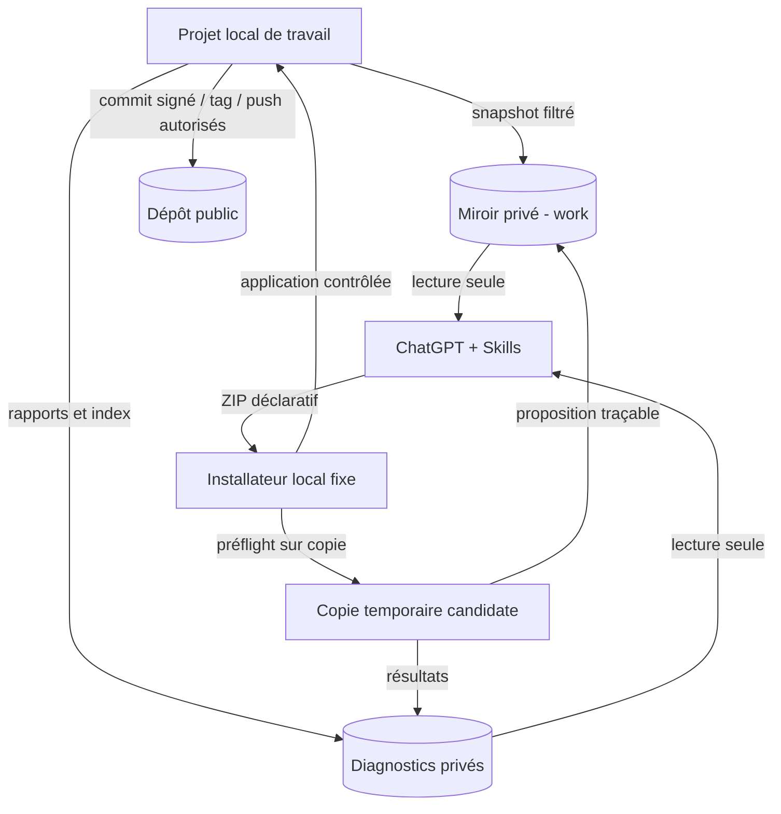

<!-- Copie de lecture pour Projet ChatGPT. Source originale: sillage-specifications/docs/architecture.md. Mise à jour manuelle requise après changement. -->

# Sillage — architecture et frontières de confiance

[Accueil](../README.md) · [Parcours](parcours.md) · [Synchronisation](synchronisation.md)

## Acteurs et dépôts

| Élément | Rôle | Écriture autorisée |
| --- | --- | --- |
| Dépôt **local de travail** | Source de vérité : HEAD, index et fichiers présents (y compris modifications non commitées) | Mainteneur et **installateur local autorisé** |
| Dépôt **miroir privé** | Instantanés exacts du code de travail (`work`) ; candidats isolés (`proposals/*`) | Service local de synchronisation uniquement |
| Dépôt **diagnostics privé** | Documentation enrichie, journaux, rapports et contextes d'exécution | Service local de synchronisation/diagnostics uniquement |
| Dépôt **public** | Historique officiel des modifications approuvées et signées | Mainteneur / outil local explicitement autorisé |
| **ChatGPT et Skills** | Lire le miroir et les diagnostics, proposer un ZIP | **Aucun droit Git en écriture** |

## Invariants

- Le miroir `work` DOIT représenter le **dernier instantané local confirmé**, pas le résultat hypothétique d'un ZIP.
- Les commits de `proposals/<id>` ne constituent **ni une installation, ni une approbation** ; même en cas d'échec des tests, la candidate PEUT rester consultable.
- Le dépôt public NE DOIT PAS être alimenté depuis les branches candidates ou depuis la documentation IA.
- Les trois dépôts distants ne partagent **aucune transaction atomique** : chaque écriture produit une trace et un état de reprise ; une publication partielle est visible et récupérable.
- La copie de travail locale peut évoluer entre deux synchronisations : `LATEST` désigne un **dernier état observé**, jamais une garantie de lecture temps réel.
- Les références utilisées pour corriger doivent identifier un **commit précis**, jamais une branche mouvante sans SHA.

## Dépôt source de Sillage : distinct des dépôts du produit

Le **code du programme Sillage** est développé dans son propre dépôt GitHub avec `main`, `develop` et des branches de phase. ChatGPT y accède en **lecture seule** à un commit exact pour les nouvelles conversations ; le mainteneur seul autorise les actions mutantes Git/`gh`, les commits et les fusions personnellement signées. Les issues, PR, SMART et hooks de ce dépôt relèvent des [conventions de développement](git-github.md) et ne sont **pas** imposés aux dépôts des projets utilisateurs. La préparation du dépôt source constitue une **pré-phase P0** ; elle ne réalise ni le miroir des projets (P1), ni leur installateur (P2), ni leur publication (P4).

Pour la maintenabilité, le code de Sillage séparera domaine/contrats, CLI, Git et GitHub, ZIP/candidate, vérifications isolées, installation, synchronisation, diagnostics et publication. Aucune classe ou couche n'est ajoutée sans nécessité : voir les [standards](developpement.md).

## Protection des accès

L'identité IA dispose au plus de `Contents: read` sur **miroir + diagnostics** pour les projets gérés, et en lecture seule sur le **dépôt source Sillage** pour le développement de ce programme. Les identifiants permettant de pousser ces dépôts et ceux permettant de publier le dépôt public sont exclusivement locaux, séparés du contexte et des scripts fournis par l'IA. Le dépôt public est accessible au monde en lecture ; il est impossible d'empêcher sa consultation publique, mais aucun accès privilégié ne lui est accordé à l'IA.

L'index de navigation et les documents explicatifs des **projets gérés** résident dans leurs diagnostics, pas dans leur miroir fidèle du code. Les fichiers `AGENTS.md` appartenant au projet restent copiés avec le code, sans modification automatique.
