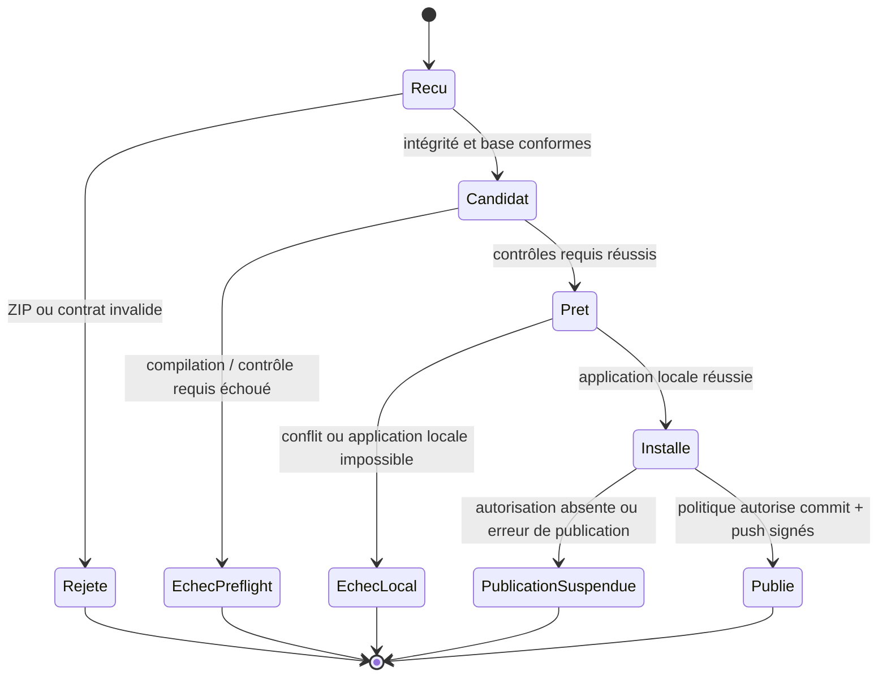

<!-- Copie de lecture pour Projet ChatGPT. Source originale: sillage-specifications/docs/parcours.md. Mise à jour manuelle requise après changement. -->

# Sillage — parcours d'un paquet et états observables

[Accueil](../README.md) · [Installateur](installateur.md) · [Publication](publication.md)

## Transitions autorisées

## Obligations de traitement

| Moment | Effet sur le code | Effet sur les dépôts privés |
| --- | --- | --- |
| Paquet reçu | Calculer `package_id = sha256:<empreinte du ZIP>` et contrôler structure/contrats | Ouvrir un `run_id` ; si la base ne peut être vérifiée, publier `runs/<run-id>/rejection.md` et non un rapport JSON fictif |
| Candidat construit | Appliquer les changements **uniquement sur copie isolée** depuis le `base_snapshot` exact | Pousser `proposals/<id>` si la candidate existe et si la connexion fonctionne |
| Échec du préflight | Ne pas modifier le code local ; aucune suite unitaire/E2E automatique | Publier la candidate (si produite), le rapport d'échec et les logs filtrés ; `work` reste inchangé |
| Succès du préflight | Comparer de nouveau l'état local avec les préconditions | Candidate traçable ; aucun commit public |
| Échec de l'application locale | Ne pas prétendre que la candidate est installée ; restaurer si une écriture partielle s'est produite et que la restauration est sûre | Publier la réalité observée, l'erreur et l'état de récupération |
| Installation locale réussie | Modifications présentes localement, **sans commit officiel à ce stade** | Capturer `work` à partir du local et mettre les diagnostics à jour |
| Autorisation de publication | Commit limité aux chemins approuvés, signé ; tag signé seulement sur version explicitement définie ; push sans force | Enregistrer le commit/tag public réellement obtenu, ou la cause du blocage |

Si la création du candidat est impossible (ZIP invalide, conflit au patch), **aucun code candidate fictif** n'est poussé : le miroir conserve le dernier `work`, et les diagnostics enregistrent l'échec.

## Traçabilité

- `package_id` : SHA-256 du ZIP reçu, calculé hors de l'archive (pas d'auto-référence).
- `run_id` : identifiant unique de la tentative, stable pendant ses mises à jour de rapport.
- `base_snapshot` : empreinte canonique de l'état local attendu ; **ce n'est pas nécessairement HEAD**, car des modifications non commitées sont représentées.
- `proposal_commit` : commit technique temporaire du miroir, distinct des commits signés officiels.
- `work_snapshot` : empreinte de l'état local **réellement** observé après application ou restauration.
- `public_commit` et `tag` : renseignés **seulement après succès vérifié** des opérations correspondantes.

Les contrôles fonctionnels automatiques sont limités aux validations structurelles, statiques, syntaxiques et de compilation applicables dans une isolation vérifiée ; les tests unitaires requièrent une approbation **manuelle distincte**, jamais un déclenchement automatique. Un contrôle impossible à isoler ne vaut pas `ready`. Les tentatives de correction automatique sont plafonnées localement.

Les commits techniques du miroir DOIVENT contenir des trailers tels que `AI-Package`, `Run-ID`, `Snapshot-ID`, `Snapshot-State`. Ils ne sont jamais fusionnés dans l'historique public.

## Reprise sans confusion

Chaque étape distante est *idempotente* (le même `run_id` et le même contenu ne produisent pas une nouvelle proposition). En cas de coupure réseau, le service conserve les écritures à réessayer dans un journal local. Un échec de publication n'annule pas à lui seul le code local installé ; les rapports doivent distinguer `installed`, `published` et `publish_failed`. De même, un push **privé** échoué conserve `installed` et signale séparément une synchronisation `pending`/`degraded`. `latest_run` n'est pas avancé vers un `rejection.md`.
