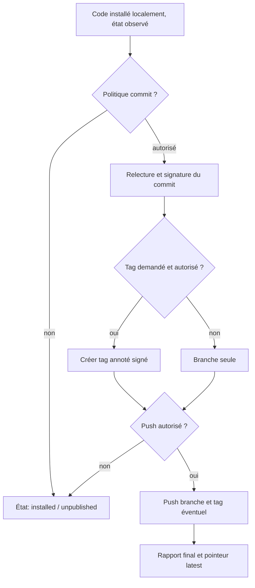

<!-- Copie de lecture pour Projet ChatGPT. Source originale: sillage-specifications/docs/publication.md. Mise à jour manuelle requise après changement. -->

# Sillage — gouvernance, signatures et publication

[Accueil](../README.md) · [Parcours](parcours.md) · [Politique JSON](../schemas/v1/policy.schema.json)

## Autorité

Le dépôt public d'un **projet utilisateur géré par Sillage** est alimenté **uniquement depuis son dépôt local**. Le workflow des PR/fusions du **dépôt source Sillage** est décrit séparément dans [Git/GitHub](git-github.md) ; il n'est pas imposé aux projets utilisateurs. La réussite du préflight n'autorise pas à elle seule un commit, tag ou push. La [politique locale de projet](../schemas/v1/policy.schema.json), installée hors des ZIP et modifiable seulement par le mainteneur, gouverne chaque action.

| Opération | Prérequis communs | Garde supplémentaire |
| --- | --- | --- |
| Application locale | ZIP valide, préflight `ready`, base encore identique | Autorisation locale d'installation, requise selon configuration |
| Commit officiel | Installation réelle réussie, chemins et diff approuvés | Signature avec clé locale, politique `ask` ou autorisation préalable explicite |
| Tag | Commit officiel confirmé ; version explicite renseignée | Tag annoté et signé ; nom libre et inexistant ; pas de tag automatique par ZIP |
| Push public | Commit signé, branche autorisée, dépôt distant contrôlé | Politique `ask` ou autorisation préalable explicite, refus des non-fast-forward et du force-push |

Par défaut : `commit=ask`, `tag=never`, `push=ask`. Une politique préautorisée reste possible, mais **doit résulter d'un choix explicite du mainteneur** ; aucune instruction du Skill ou du manifeste ZIP ne peut changer cette autorisation.

## Contrôle du diff publié

Le système NE DOIT PAS inclure des changements sans rapport avec le paquet : ni fichiers secrets, ni fichiers déjà indexés par l'utilisateur sans consentement, ni changements apparus pendant l'opération. Il contrôle la sélection exacte, le diff de l'**index temporaire ou équivalent**, l'état de la branche et l'identité de signature avant engagement. Si la création du commit avance `HEAD`, l'index habituel DOIT être réconcilié sans perdre les changements pré-indexés étrangers au lot ; sinon l'opération est refusée avant déplacement de `HEAD`.

Le message du commit PEUT inclure le trailer `AI-Package: sha256:...` et `Run-ID: ...` ; aucun lien vers un rapport sensible n'est ajouté au dépôt public sans approbation. Un paquet peut conduire à **zéro** commit officiel (refus, changes déjà committés, publication désactivée).

Une signature valide authentifie l'objet signé, pas la correction fonctionnelle du code ; le caractère privé du miroir et son SHA ne remplacent pas la vérification des changements approuvés. La clé de signature reste locale, jamais accessible à l'IA.

## Séquence de publication

Lorsqu'un serveur Git prend en charge `git push --atomic`, branche et tag peuvent être mis à jour dans une même opération distante. Sinon, l'outil doit traiter et rapporter les éventuelles publications partielles, **sans forcer** les références.

Un échec de push vers le miroir ou les diagnostics ne requalifie jamais une application locale réussie en échec d'installation : conserver `installed` et rapporter séparément `pending`/`degraded`.

Le dépôt miroir peut rester à l'état de travail (non approuvé) après commit officiel ; la synchronisation suivante doit enregistrer le nouveau `HEAD` public sans falsifier le snapshot de fichiers.

## Erreurs et statut

- Signature impossible → `publish_failed`, aucun commit non signé de remplacement.
- Tag existant → refus d'écrasement ; un commit déjà créé reste traçable.
- Rejet du push / absence de réseau → commit local conservé, `publish_failed`, reprise explicitement traçable.
- GitHub ou le connecteur IA indisponible → aucun changement d'autorité ; les dépôts privés et les journaux locaux indiquent la dernière opération effectivement confirmée.
- **Interdit** : `git push --mirror`, `--force`, `--force-with-lease` automatiques vers le dépôt public, signature au nom de l'IA, tag créé à partir du numéro de paquet sans politique de version.
